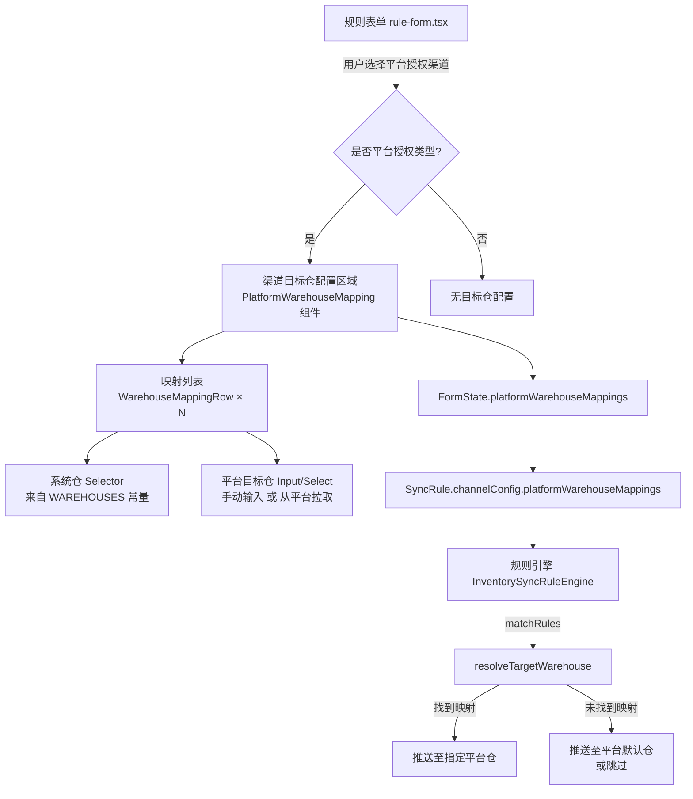
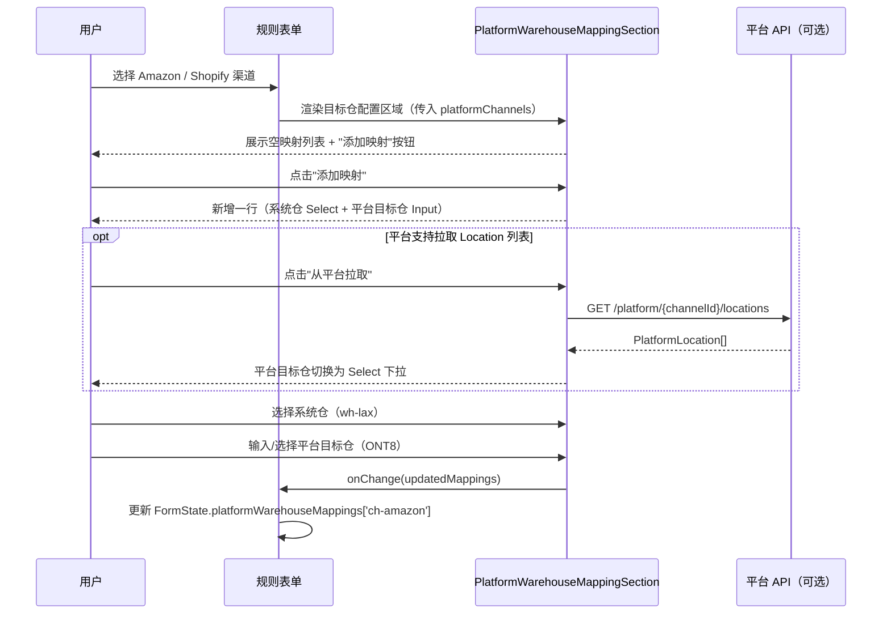
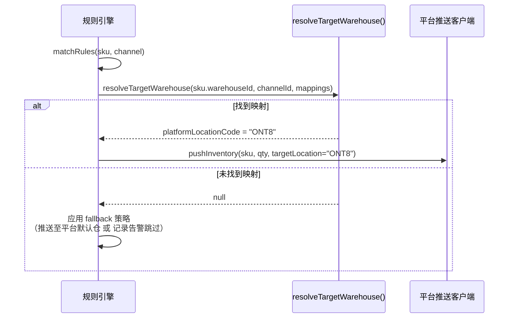

# 设计文档：渠道目标仓配置（inventory-sync-platform-warehouse）

## Overview

在库存同步规则的"同步渠道"配置环节，当用户选择了 Amazon、TikTok Shop 或 Shopify US 等**平台授权**类型渠道后，新增一个"目标仓映射"配置区域，允许用户定义系统内部仓 → 平台目标仓/Location 的多条映射关系。规则引擎在执行库存推送时，根据这组映射决定每条 SKU 的库存数据应推送至哪个平台侧仓库（Fulfillment Center / Location ID）。

本功能仅针对平台授权类渠道生效，EDI 渠道（Walmart / Target / Costco 等）和文件传输渠道（Wayfair）不涉及目标仓配置。

---

## Architecture



---

## Components and Interfaces

### 组件一：`PlatformWarehouseMappingSection`

**用途**：嵌入规则表单"同步渠道"Section 内，仅当选中平台授权类型渠道时渲染。

**接口**：

```typescript
interface PlatformWarehouseMappingSectionProps {
  /** 当前已选的平台授权渠道列表 */
  platformChannels: PlatformChannel[]
  /** 当前映射配置 */
  mappings: PlatformWarehouseMapping[]
  /** 映射变更回调 */
  onChange: (mappings: PlatformWarehouseMapping[]) => void
}
```

**职责**：
- 渲染映射条目列表（每行：系统仓 → 平台目标仓）
- 提供"添加映射"按钮
- 提供每行的删除操作
- 多渠道选中时，展示渠道分组标签

---

### 组件二：`WarehouseMappingRow`

**用途**：单条映射行，包含左侧系统仓选择器和右侧平台目标仓输入。

**接口**：

```typescript
interface WarehouseMappingRowProps {
  mapping: PlatformWarehouseMapping
  channelId: string
  platformName: string
  onUpdate: (mapping: PlatformWarehouseMapping) => void
  onRemove: () => void
  /** 该渠道是否支持从平台拉取 Location 列表 */
  supportsLocationFetch: boolean
  /** 已从平台拉取的 Location 选项（仅 supportsLocationFetch=true 时有效） */
  platformLocations?: PlatformLocation[]
}
```

**职责**：
- 渲染系统仓下拉选择器（从 WAREHOUSES 常量取值）
- 渲染平台目标仓输入框（或下拉选择器）
- 支持从平台 API 拉取 Location 列表后切换为 Select 模式

---

### 组件三：规则引擎扩展 `resolveTargetWarehouse()`

**用途**：在执行同步推送前，查找给定内部仓与渠道对应的平台目标仓代码。

**接口**：

```typescript
function resolveTargetWarehouse(
  warehouseId: string,
  channelId: string,
  mappings: PlatformWarehouseMapping[]
): string | null
```

**职责**：
- 根据 warehouseId + channelId 精确匹配映射条目
- 返回匹配到的 `platformLocationCode`
- 未找到时返回 `null`（由调用方决定 fallback 策略）

---

## Data Models

### 新增类型：`PlatformWarehouseMapping`

```typescript
/**
 * 单条"系统仓 → 平台目标仓"映射
 */
export interface PlatformWarehouseMapping {
  /** 系统内部仓 ID，对应 WAREHOUSES[].id */
  warehouseId: string
  /** 平台目标仓标识，如 Amazon FC 代码 "ONT8"、Shopify Location ID "12345678" */
  platformLocationCode: string
  /** 可选：平台目标仓展示名称（拉取后填充，存储用） */
  platformLocationName?: string
}
```

---

### 新增类型：`ChannelConfig`

```typescript
/**
 * 渠道级别的额外配置，仅平台授权渠道需要
 */
export interface ChannelConfig {
  channelId: string
  /** 平台目标仓映射列表 */
  platformWarehouseMappings: PlatformWarehouseMapping[]
}
```

---

### 新增类型：`PlatformLocation`（平台 API 返回）

```typescript
/**
 * 从平台 API 拉取的目标仓/Location 信息
 */
export interface PlatformLocation {
  code: string
  name: string
  /** 国家/地区 */
  country?: string
  /** 是否可用 */
  active: boolean
}
```

---

### 修改：`FormState`（rule-form.tsx）

在现有 `FormState` 中增加一个字段：

```typescript
type FormState = {
  // ...existing fields...
  
  /**
   * 按渠道 ID 索引的目标仓映射配置
   * 只有平台授权类型渠道会有此配置
   * key: channelId (如 'ch-amazon' | 'ch-shopify')
   */
  platformWarehouseMappings: Record<string, PlatformWarehouseMapping[]>
}
```

**默认值**：

```typescript
const DEFAULT_FORM: FormState = {
  // ...existing defaults...
  platformWarehouseMappings: {},
}
```

---

### 修改：`SyncRule`（types/index.ts）

在 `SyncRule` 接口的 `actions` 中增加渠道配置字段：

```typescript
export interface SyncRule {
  // ...existing fields...
  actions: {
    // ...existing action fields...
    
    /**
     * 平台渠道目标仓配置（平台授权类渠道专用）
     * key: channelId
     */
    channelConfigs?: Record<string, ChannelConfig>
  }
}
```

---

## 序列图：用户配置目标仓映射



---

## 序列图：规则引擎执行目标仓解析



---

## UI 交互设计

### 显示条件

仅当以下条件同时满足时，渲染"渠道目标仓配置"区域：

```typescript
const platformChannels = selectedChannels.filter(ch => ch.type === '平台授权')
const showPlatformWarehouseConfig = platformChannels.length > 0
```

### 布局结构

```
同步渠道 Section
├── 目标渠道 MultiSelect（已有）
├── [条件渲染] EDI Retailer 字段（已有）
└── [条件渲染] 渠道目标仓配置
    ├── 区域标题：「目标仓映射」+ 说明文字
    ├── [多渠道时] 渠道 Tab 切换（ch-amazon / ch-shopify）
    └── 映射列表
        ├── 映射行 1：[系统仓 Select] → [平台目标仓 Input/Select] [删除]
        ├── 映射行 2：[系统仓 Select] → [平台目标仓 Input/Select] [删除]
        └── [添加映射 按钮]
```

### 表单字段规范

| 字段 | 类型 | 占位符 | 校验 |
|------|------|--------|------|
| 系统仓 | Select | 请选择系统仓 | 必填；同一渠道内不能重复 |
| 平台目标仓 | Input 或 Select | 如：ONT8 / Location ID | 必填；非空字符串 |

### 校验规则

1. 同一渠道内，系统仓不能重复出现（每个内部仓只能映射一个目标仓）
2. 已添加映射行时，系统仓和平台目标仓均为必填
3. 允许同一系统仓映射至不同渠道的不同目标仓（跨渠道允许重复）
4. 允许不配置任何映射（规则仍可保存，此时同步时采用平台默认仓）

### 视觉状态

- 未选平台授权渠道：配置区域不渲染
- 已选 1 个平台授权渠道：直接展示该渠道的映射列表，无需 Tab
- 已选 2+ 个平台授权渠道：顶部展示渠道 Tab，切换渠道查看/编辑各自映射

---

## Error Handling

| 场景 | 处理方式 |
|------|---------|
| 用户未配置任何映射即保存 | 允许，规则执行时使用平台默认仓 fallback |
| 系统仓重复配置（同渠道） | 表单内联错误提示：「该仓库已存在映射，请勿重复配置」|
| 平台目标仓代码为空 | 行级必填校验，阻止保存 |
| 从平台拉取 Location 失败 | Toast 错误提示，降级为手动输入模式 |
| 规则执行时找不到对应映射 | 记录 warn 日志，采用 fallback：推送至平台默认仓（如有）或跳过该仓并告警 |

---

## Testing Strategy

### 单元测试

- `resolveTargetWarehouse(warehouseId, channelId, mappings)` 的正向/边界/无映射场景
- `PlatformWarehouseMappingSection` 渲染条件：平台授权渠道选中/未选中时的挂载/卸载
- 校验逻辑：同渠道内系统仓重复时的错误状态

### 属性测试（Property-Based Testing）

**属性 1**：映射幂等性
> 对任意 `warehouseId` 和 `channelId`，若 `mappings` 中存在唯一匹配项，`resolveTargetWarehouse` 始终返回相同的 `platformLocationCode`

**属性 2**：无映射时返回 null
> 若 `mappings` 为空数组，`resolveTargetWarehouse` 对所有输入均返回 `null`

**属性 3**：同渠道内系统仓唯一性
> 对任意合法的 `platformWarehouseMappings[channelId]` 数组，其中 `warehouseId` 值两两不同

### 集成测试

- 用户选择 Amazon 渠道 → 配置 2 条映射 → 保存规则 → 规则对象中 `channelConfigs` 字段正确存储
- 规则引擎在执行批量 SKU 同步时，正确调用 `resolveTargetWarehouse` 并将结果传递给推送客户端

---

## Correctness Properties

*属性是在系统所有合法执行路径中均应成立的行为特征——即对"系统应该做什么"的形式化陈述。属性是人类可读规格说明与机器可验证正确性保证之间的桥梁。*

### Property 1: 平台授权渠道显示控制的单调性

*对任意*包含至少一个 `type === '平台授权'` 渠道的渠道选择集合，规则表单应当渲染目标仓映射配置区域；对不包含任何平台授权渠道的渠道选择集合（包括空集合），规则表单不应渲染该配置区域。

**Validates: Requirements 1.1, 1.2**

### Property 2: 映射添加后列表包含性

*对任意*当前渠道的映射列表和任意合法的映射条目（`warehouseId` 非空、`platformLocationCode` 符合格式规范），执行添加操作后，该映射列表中应包含新添加的条目，且原有条目均完整保留。

**Validates: Requirements 2.2**

### Property 3: 映射删除的精确性与不变式

*对任意*含有 N 条（N ≥ 1）映射条目的列表，删除其中任意一条后，列表长度应变为 N-1，且被删除条目不再出现在列表中，其余 N-1 条条目内容和顺序完全不变。

**Validates: Requirements 2.3**

### Property 4: 多渠道 Tab 显示阈值

*对任意*已选平台授权渠道的数量 N，当 N ≤ 1 时不应渲染渠道 Tab 切换器；当 N ≥ 2 时应渲染渠道 Tab 切换器，且 Tab 数量等于 N。

**Validates: Requirements 3.1, 3.2**

### Property 5: 跨渠道映射数据隔离性

*对任意*两个不同渠道 A 和 B，对渠道 A 的映射列表执行任意增删改操作，不应影响渠道 B 的映射列表；反之亦然。

**Validates: Requirements 3.3, 3.4**

### Property 6: 同渠道内系统仓唯一性

*对任意*合法的渠道映射列表，其中任意两条不同的映射条目的 `warehouseId` 值不能相同（即同一渠道内每个系统仓最多出现一次）。

**Validates: Requirements 4.3**

### Property 7: 规则保存的 Round-Trip（存储往返一致性）

*对任意*合法的 `FormState.platformWarehouseMappings` 配置（包含零条或多条映射），将其序列化到 `SyncRule.actions.channelConfigs` 后再反序列化回 `FormState.platformWarehouseMappings`，应得到与原始配置等价的数据对象。

**Validates: Requirements 5.1, 5.3**

### Property 8: resolveTargetWarehouse 的精确匹配性

*对任意*映射数组 `mappings`、仓库 ID `warehouseId` 和渠道 ID `channelId`，若 `mappings` 中存在且仅存在一条满足 `m.warehouseId === warehouseId && channelId 匹配` 的条目 m，则函数返回值应严格等于 `m.platformLocationCode`，不返回其他任何条目的代码。

**Validates: Requirements 6.1, 6.2**

### Property 9: resolveTargetWarehouse 的幂等性（纯函数）

*对任意*相同的 `warehouseId`、`channelId` 和 `mappings` 输入，无论调用多少次，`resolveTargetWarehouse` 始终返回相同的结果。

**Validates: Requirements 6.3**

### Property 10: 空映射列表时全部返回 null

*对任意* `warehouseId` 和 `channelId`，当 `mappings` 为空数组时，`resolveTargetWarehouse` 始终返回 `null`。

**Validates: Requirements 7.2**

### Property 11: 无匹配条目时返回 null

*对任意*不包含 `warehouseId` + `channelId` 匹配条目的 `mappings` 数组，`resolveTargetWarehouse(warehouseId, channelId, mappings)` 应返回 `null`，不返回任何其他条目的 `platformLocationCode`。

**Validates: Requirements 7.1**

---

## 依赖

| 依赖 | 说明 |
|------|------|
| `WAREHOUSES`（rule-form.tsx） | 系统内部仓列表来源，现有常量无需修改 |
| `CHANNELS`（rule-form.tsx） | 通过 `channel.type === '平台授权'` 判断是否需要目标仓配置 |
| `SyncRule`（types/index.ts） | 新增 `channelConfigs` 字段扩展 actions |
| `InventorySyncRuleEngine`（rule-engine.ts） | 新增 `resolveTargetWarehouse` 方法 |
| 平台 API（未来） | Amazon SP-API `getInventorySummaries` / Shopify Locations API，用于拉取 Location 列表；初期可为手动输入，不强依赖 |

---

## 性能考虑

- 映射配置存储在规则对象内（嵌套数据），无需额外数据表，查询路径短
- `resolveTargetWarehouse` 为简单线性查找，映射条数通常 ≤ 10，性能无忧
- 从平台拉取 Location 列表时应缓存结果（per session），避免重复 API 调用

---

## 安全考虑

- 平台目标仓代码由用户填写或从平台 API 拉取；前端仅展示，不执行，无 XSS 风险
- 保存时对 `platformLocationCode` 做非空 + 字符白名单校验（字母/数字/-/_，最大 64 字符），防止注入异常数据进入下游推送调用
- 平台 API 凭证（Access Token）由已有 `CarrierAuth` / 平台授权体系管理，本功能不新增凭证字段
