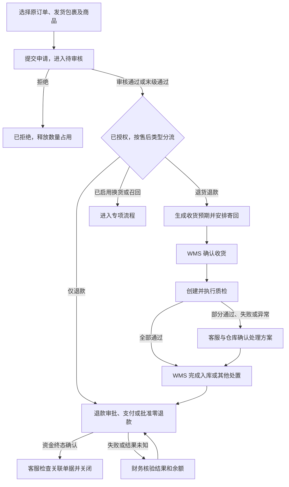

# OMS 售后申请产品需求文档

V2.0 · 2026-11-19 · 评审稿

本稿正文为拟交付规则。第 10 节列出待确认的业务决策与会影响验收的原型差异。

## 1. 业务目标与范围

售后申请（RMA）是关联原销售订单的售后主单。客服通过它受理、审核并跟进售后，仓库通过退货收货单与质检单处理实物，财务通过退款单处理资金。系统依据各单据已确认的结果展示进度及待办。

| 范围 | 交付内容 |
| --- | --- |
| 首期基线 | 手工创建、仅退款、退货退款、B2C/B2B 审核、逆向物流、WMS 收货、质检、库存处置、退款及关闭。各能力按商家、渠道、仓库和支付服务配置生效。 |
| 扩展场景 | 换货、在途召回、AX 退单接入。保留原型入口和业务规则定义，具体开放条件见第 10 节。已存在的历史单据可查询。 |
| 关联单据 | 原销售订单及原发货包裹、Shipment（运单）、退货收货单 RN、质检单、退款单。售后申请通过 ID 关联各单据并显示状态。 |

**使用角色**　客服创建及跟进，审批人审核，仓库确认收货和处置，质检人员完成实物检查，财务审核和执行退款，授权客服或运营关闭售后申请。

## 2. 业务流程

审批后安排面单或揽收，只有实际发运确认后进入运输中。仓库先收到有效收货回执时，可直接推进至已签收。符合取消条件的申请可从相应阶段进入已取消。

## 3. 状态与流转

### 3.1 状态定义

| 状态 | 状态编码 | 可操作项与推进条件 |
| --- | --- | --- |
| 待审核 | pending | 客服查看和补充内部备注；审核角色授权、拒绝或确认撤销。拒绝、撤销必填原因。B2B 最后一级审批通过才授权。 |
| 已授权 | authorized | 仅退款创建或打开退款单。实物退货安排物流并建立收货预期。按条件取消。 |
| 面单就绪 / 揽收已预约 | label_generated / pickup_arranged | 查看或更新对应物流信息。承运商已揽收、发出或经授权确认后进入运输中；仓库已有有效签收结果时可直接转已签收。 |
| 运输中 | in_transit | 查询轨迹，允许有权人员按仓库凭据签收。取消需先确认物流可撤销及仓库未收货。 |
| 已签收 | received | 查看收货明细，创建或打开质检单。进入质检以质检单开始事件为准。 |
| 质检中 | inspecting | 查看进度和复核状态；质检最终完成后更新主单并显示结论。 |
| 质检通过 / 质检不通过 | inspection_passed / inspection_failed | 查看明细、处置建议及仓库任务。部分通过单独显示结论并进入人工确认；现有编码可落入异常处理组，确认后推进。 |
| 已入库 | stocked_in | 仓库完成入库或处置，允许创建或打开对应退款单。零良品场景显示“处置完成”说明。 |
| 退款处理中 | refund_processing | 跟踪退款审批、发起、失败及回执，保留失败和处理中的流水。 |
| 已关闭 / 已拒绝 / 已取消 | completed / rejected / cancelled | 可查看关联单据和时间线。业务纠正走有权限的独立流程并保留记录。 |

### 3.2 状态迁移及事件

| 原状态 | 触发与判定 | 目标状态 | 未满足时 |
| --- | --- | --- | --- |
| 无 | 请求有效，数量占用成功 | pending | 不创建申请。 |
| pending | B2B 当前级通过，仍有未完成审批 | pending | 顺序不符拒绝并提示当前层级。 |
| pending | 审批通过或最后一级通过 | authorized | 无权限或版本不一致不变更。 |
| pending | 审批拒绝并记录原因 | rejected | 原因缺失，不推进。 |
| authorized | 承运商成功返回预付面单 / 成功预约揽收 | label_generated / pickup_arranged | 保持 authorized，记录失败或查询中。 |
| authorized / label_generated / pickup_arranged | 可验证的揽收/发运事件，或召回接管后确认返仓在途 | in_transit | 仅录入运单号或创建面单，不推进。 |
| authorized / label_generated / pickup_arranged / in_transit | 有效 WMS 实收明细提交；自送可从 authorized 直接签收 | received | 到仓无法匹配、超收或证据不符均进入仓库异常。 |
| received | 有效质检单开始 | inspecting | 草稿创建不推进。 |
| inspecting | 最后一张有效质检在得出结论前取消，当前已签收范围无进行中的质检 | received | 仍有有效质检在进行时保持 inspecting。 |
| inspecting | 应处理范围已质检完，最终全部通过 / 部分通过或失败 | inspection_passed / inspection_failed | 复核打回、部分批次未检或未判定短收时保留阶段。 |
| inspection_passed / inspection_failed | 收货范围已结清，WMS 已确认全部处置，异常路径已审批 | stocked_in | 已登记暂存且待必要上架时保留原状态，显示仓库实际进度。 |
| authorized（仅退款）/ stocked_in | 退款单持久化创建成功 | refund_processing | 重复创建打开有效子单，金额未核实则不推进。 |
| refund_processing | 资金终态成功，或正式批准零退款 | refund_processing，标记可关闭 | 若处理失败或未知，保持阶段并引导财务核验。 |
| refund_processing 或专项允许的合格状态 | 各类型关单条件齐备且点击关闭 | completed | 返回未完成的具体审批、库存、退款或换货履约项。 |
| 可取消状态 | 授权撤销及外部撤销成功 | cancelled | 原状态保留并显示取消待处理。 |

主状态推进和外部任务状态分别保存。RMA 单号、RN（仓库收货号）、QC 单号和支付单号各自保留。迟到回调只补证据或补完缺项，不覆盖更高阶段。若回调实际上改变已关闭业务事实，建立异常记录并通知相应岗位处理。

单据终态为 completed、rejected 或 cancelled，对应各自结案原因。自动回写与人工动作均按有效迁移表执行。质检扫描、复核、退款或仓库子流程状态在关联区域展示。

## 4. 列表、查询与展示

| 项目 | 输入与取值 | 执行及反馈 |
| --- | --- | --- |
| 数据范围 | 当前租户、公司与已授予的商家；全部商家仅聚合授权范围 | 先限定权限再查询。无权限单据不进入列表、计数、选项或导出。新建必须落在具体商家。 |
| 关键词 | 退货单号、原订单号、客户名、客户公司、任一关联退货运单号 | 取首尾空白后的整串，按不区分大小写的包含匹配，各字段 OR。保留连字符及内部空格。支持粘贴一个完整值，空串视为未搜索。订单和物流均从对应关联取值。 |
| 类型 | 仅退款、退货退款、换货、在途召回 | 单选精确匹配 returnType。关闭新建的历史类型仍可筛选已有数据。 |
| 渠道 | 依权限及商家店铺配置，例如 Shopify、Amazon、TikTok Shop、Walmart、Direct | 以渠道编码单选精确匹配。显示渠道名称，名称更改不改变历史归属。 |
| 客户类型 | B2B、B2C | 匹配订单创建时的客户类型快照。历史空值仅在可从订单确认时补齐，否则类型显示未知并只在全部条件下返回。 |
| 申请日期 | 起始、结束可分别为空 | 按列表业务时区解释日期，查询区间为起始日零点（含）至结束日次日零点（不含），转换为 UTC 后查询 createdAt。起始晚于结束时提示“开始日期不能晚于结束日期”，保留上次结果。 |
| Tab 与计数 | Tab 按本节映射；同一记录只进一个状态组 | 非状态条件之间 AND；关键词命中后仍须满足筛选与 Tab。计数基于同一非状态条件计算，切 Tab 不重置搜索或筛选。 |
| 查询提交 | 输入防抖 300 ms；Enter 立即提交；清空搜索或筛选立即查询 | 任一查询项变化回到第 1 页，清空当前勾选，丢弃旧请求的迟到结果。非法输入保留上次成功结果。 |
| 默认排序 | 申请时间倒序 | createdAt DESC、id DESC 打破同时间并列。 |
| 可选排序 | 申请时间、最后更新时间，可升可降 | 每次只应用一个主排序，同值按 id 同方向排列，空时间置底。选择、重置排序均回到第 1 页；返回列表恢复当前条件、页码和排序。 |
| 分页 | 默认 20 条，可选 20 / 50 / 100 | 服务端分页，返回命中总数；先过滤再排序分页。切每页条数回第 1 页。末页清空时回到最后一个有效页。 |
| 选择与导出 | 有选择时使用选中记录；无选择时使用当前全部匹配记录 | 选择限当前页，换页清除。开放导出权限后，按列表排序与字段出表，带原币代码与明确金额口径，反馈导出行数。导出时重验权限。 |
| 空态及失败 | 初始无数据、条件无匹配、查询失败 | 分别展示“暂无售后申请”“未找到匹配记录”“查询失败，重试”。查询失败禁止以空列表报成功。 |

**Tab 映射**　待审核 = pending；待发货 = 实物单 authorized / label_generated / pickup_arranged；待签收 = in_transit；待质检 = received / inspecting；待入库 = inspection_passed / inspection_failed；待退款 = 仅退款 authorized 及 stocked_in / refund_processing；已关闭、已拒绝、已取消分别对应 completed、rejected、cancelled。换货和召回沿相同实物阶段显示，并额外展示专项子状态。质检异常仍处在待入库阶段，显示“待确认处置”。若退款成功但未手动关闭，仍在待退款 Tab 并展示“可关闭”。

| 列表列 | 数据来源与显示 |
| --- | --- |
| 勾选、操作 | 勾选按售后 ID；查看详情按 ID 跳转。原订单与退货单分别链接到授权详情，操作列只展示当前可执行项。 |
| 退货单号、原订单 | 后端生成的 RMA 编号和订单快照号；外部退单号只补充展示。 |
| 类型、渠道 | 分别按 returnType 和订单渠道编码映射；历史未知值显示“未知”。 |
| 客户 | 订单快照客户名，B2B 有公司时附公司。缺失显示“—”，列表无需返回邮箱。 |
| 退货商品 | 按申请行创建顺序展示前 2 行，格式为商品名 / SKU × 申请数量；剩余显示“+N 行”，N 为剩余行数。详情显示全部行及总件数。 |
| 寄回方式 | 基于 shipMethod 字典；仅退款显示“无需寄回”。 |
| 退款金额 | 列表使用列名“已退金额”，取成功流水合计，待支付显示“—”，获批零退款显示“0 + 币种”。详情分别显示预计、已审批、处理中、已退，禁止跨币种求和。 |
| 状态 | 主状态标签取服务端状态。B2B 审批、质检异常、物流或付款异常以次级标签展示；显示文案不参与状态判定。 |
| 申请时间、最后更新时间 | 分别取创建时间和最后一次业务写入时间。显示业务时区的日期，详情展示日期和时分秒；列表可补列最后更新时间。 |

## 5. 页面交互与动态字段

| 页面 | 入口与交互 |
| --- | --- |
| 列表 | 售后管理 → 售后申请。新建、搜索、筛选、查看关联原订单和进入详情。 |
| 新建 | 先选原订单与发货包裹，再选售后类型、商品行和对应处理方式。提交成功后返回列表，显示创建的 RMA 号及详情入口。表单失败保留已填内容并定位错误字段。 |
| 详情 | 头部展示 RMA 单号、类型、状态、异常标识及可操作按钮。正文展示商品、审批、关联单据、物流、退款摘要、内部备注和操作时间线。 |
| 关联单据 | 有真实单号时展示单号、状态及查看入口。未创建显示前置条件或失败原因。只在有权限且满足前置条件时提供创建操作。 |

### 5.1 新建表单的动态显示及重置

| 触发条件 | 展示及可编辑字段 | 取值和重置逻辑 |
| --- | --- | --- |
| 初次打开 | 原订单、售后类型、商品区、内部备注 | 类型默认退货退款。未选订单和包裹时禁用选品和提交。 |
| 选择或切换原订单 | 订单号、渠道、店铺、客户类型与原地址摘要只读。发货包裹可选。 | 单个有效包裹可默认；多个由客服选择。换订单前提示清空包裹、退货商品、换货商品、B2B 输入及由旧订单继承的地址和资金信息。取消切换保留原值。 |
| 选择或切换包裹 | 展示该包裹的原运单和商品候选，以及逐行可申请量。 | 切换后清空旧包裹选中行及金额估算；同 SKU 不同原订单行分别展示。 |
| 仅退款 | 显示退款方式与含运费退款选项，隐藏寄回方式、仓库、偏好承运商及返件表单。 | 写入无需退货。切回实物类型后恢复可配置的默认寄回方式，无有效默认时要求重选；重新计算仓库与承运商候选。提交数据按新场景生成。 |
| 退货退款 | 显示寄回方式、退货仓、退款方式；预付面单或上门揽收时可选偏好承运商。 | 客户自寄在详情录入运单；预付面单在详情确认地址并发起制单；上门揽收在详情补填联系人、地址、日期与时段；送至收件点使用仓库可用收件点。切方式清空已不适用的未提交物流输入。 |
| 含运费退款 | 符合政策时在使用退款单的类型中显示。获准后展示原运费与剩余可退运费。 | 默认关闭。关闭后本次运费金额为零。若所选渠道或政策不允许，则禁用或隐藏，并提示原因。 |
| B2B 原订单 | 显示买方 PO、合同号和审批策略。支持的结算方式依客户合同加载。 | 客户类型以订单快照为准。PO、合同优先带入；缺值是否必填依策略。审批层级从已配置策略带入，只读。切到 B2C 后提交时去掉 B2B 专属数据。 |
| 已启用换货 | 显示替换商品、规格、数量、发货地址。 | 商品从主数据选取，数量默认 1，地址需核对。切出换货时清空替换行与补发信息。 |
| 已启用在途召回 | 显示符合条件的原在途运单和可召回商品行。 | 需要承运商能力、运输状态与剩余可召回量校验。由承运商返仓，使用召回方式处理，无面单自寄字段。 |

### 5.2 详情的动态区块

| 区块 | 显示和去向 |
| --- | --- |
| 审批进度 | B2B 显示已审批级别、当前级及审批人；当前操作者有权限才出现本级按钮。终态可查历史。 |
| 物流与仓库 | 仅退款显示无需寄回，隐藏物流作业入口与仓库、质检子单。实物单按模式显示面单、揽收、运单和时间节点，信息存在时展示轨迹。最新状态取关联运单。 |
| 关联单据 | 退货退款显示收货、质检、退款。只有换货显示发货单入口。退款已创建直接查看，未创建展示门槛。 |
| 资金、客户和异常 | 展示币种、预计、审批、处理中和已退金额。运费退款、流水、B2B 合同与账期按适用性显示。拒绝、取消、异常与关单阻断显示具体原因。 |

## 6. 字段字典

共用约定：ID 按服务端原值保存，提交接口校验引用有效性；单号和运单号去首尾空白，保留原字符及前导零；空值用 null 表示，详情缺值显示“—”。字段长度与默认值按本稿验收。日期时间以 ISO 8601 保存，展示时转换为业务时区。

| 字段 | 来源、录入及默认 | 取值校验与联动 |
| --- | --- | --- |
| id / returnNo | 提交成功由服务端生成，页面只读 | id 全局唯一；returnNo 建议 RET-YYYYMMDD-流水，按业务日期生成，至少在可查询商家范围保证唯一。重复请求复用原值。 |
| tenantId / companyId / merchantId | 从会话授权与原订单读取 | 所有数据引用与写入需匹配三层作用域。商家变更须重新选单。 |
| orderId / orderNo | 订单选择器确认后带入，必填、只读快照 | 搜索订单号、客户名、公司，不区分大小写包含。只展示当前商家的消费者订单。切换订单清除包裹、商品、退款上下文和订单关联字段。 |
| packageId / fulfillmentOrderNos | 订单选定后加载已发货包裹及其履约单；单包裹可默认，多包裹必选 | 仅一个包裹，原运单号只读带入。选包裹变化清空原选商品。仅退款特殊未发货范围待定，当前按包裹校验。 |
| channel / merchant | 原订单渠道编码、店铺 ID 和名称快照，只读 | 原订单未明确渠道时展示未知。商家权限以 ID 为准。 |
| channelReturnId / Customer Requisition | 渠道或 AX 报文带入，选填，只读 | 按来源系统＋商家作用域＋外部 ID 幂等，同标识不同关键内容转冲突处理。独立保留上游 RMA Ref、RN 与原订单号。 |
| returnType / status / recallStatus | 新建默认 return_refund；创建后状态 pending；召回初始 not_requested | 类型受已启用范围和发货状态约束。提交后原类型锁定，专项变更走异常决议。主状态由第 3.2 节事件生效。 |
| customerType / customerName / customerEmail / customerCompany | 从订单客户快照带入 | 类型以订单类型为先，派生旧数据须有可追溯来源；公司名不能单独作为生产环境最终判定。邮箱用于已授权客户通知，页面按权限展示。 |
| shipMethod | 退货退款按商家设置默认；无有效默认则空。仅退款写 no_return_needed；召回使用专项返仓方式 | 可选 customer_arrange、prepaid_label、carrier_pickup、in_person_drop_off。退货退款禁选无需寄回；召回不进入此下拉。切换方式后清空不适用的物流输入；已有有效物流子单时先取消子单。 |
| returnWarehouseCode / returnWarehouse | 对当前商家启用的退货仓。仅一个值可默认；多个按商家配置默认，无配置待用户选择 | 实物单必填，保存 ID/代码及名称快照。若与原发货仓不同，按仓库能力校验。仅退款置空。标签或仓库收货单生效后禁止直接切仓。 |
| preferredCarrier | 页面可选；默认空表示系统选择 | 依仓库、国家、运输方式及承运商能力确定候选。偏好只作输入，最终承运商取成功的运单或揽收回执。 |
| returnCarrier / returnTrackingNumber / returnTrackingUrl / returnLabelUrl | 录运单、承运商结果或授权回写。初始空。URL 由已配置模板或承运商返回 | 保存承运商编码和有效运单号，保留前导零。Other 需填名称。不同 RMA 重复运单号提示并核实，不能以运单号作唯一身份。面单 URL 按客体授权读取。 |
| pickupAddress / contactName / contactPhone / scheduledDate / scheduledWindow | 优先带入原退件联系地址，操作人核对后提交，取件时窗按承运商服务区可用值 | 上门揽收必填；电话按国家格式校验；日期不可早于取件地当前日期。起止时间须有效且承运商可服务。 |
| line.id / lineItemId / sku / title / variantTitle | 行 ID 由服务生成，其他取订单发货行快照 | 选品按 SKU、标题不区分大小写包含。使用原订单行 ID 去重，同 SKU 不同行保留。选品不允许手工输入未发货商品。 |
| line.quantity / maxQty | quantity 正整数，默认 1；maxQty 按第 7.1 节实时计算 | 1 ≤ quantity ≤ maxQty；金额与数量变化后重算。maxQty 为 0 的商品不能选。提交出现并发上限下降时保留原录入并提示新上限。 |
| line.reason / reasonNote | 无默认原因，提交前必选 | quality_issue 质量问题、not_as_described 与描述不符、wrong_item 发错、damaged_in_transit 运输损坏、changed_mind 反悔、duplicate_order 重复下单、size_fit_issue 规格不符、other 其他。other 需说明，建议最多 500 字。 |
| currency / line.refundAmount / totalRefundAmount | 原支付币种。金额由服务计算并按币种小数位显示 | 定义预计、批准与已退三种口径。商品预计退款取分摊至所选原订单行的实付额度；订单剩余商品实付、运费余额和所有预占额度同时校验。多次部分退最后一笔仅可消耗实际剩余，避免重复分摊。 |
| refundMethod / refundShipping / shippingRefundAmount | 默认原路退、运费退款默认否，金额默认 0 | 支持网关、商家策略及角色共同允许的方式。Credit Memo 仅适用于启用该能力的 B2B。换货为业务类型。含运费退款开启后，按已付未退运费及渠道策略算上限，金额为空不得提交有金额的退款请求。 |
| buyerPoNo / contractNo / creditTermDays | 优先带入订单采购信息和客户合同，按配置决定必填及可编辑性 | 编号建议 64 字符内。信用账期从合同同步，保存非负整数天，缺失留空。 |
| approvalLevel / approvedLevels / currentApprover | 按商家、金额、合同等策略解析，建议 1–3 级。已审批初始 0；当前审批人按权限路由 | B2B 发起时固化策略版本。逐级审批，同一级重复事件幂等。最终授权由最后一级通过触发。 |
| restockingFeeRate / restockingFeeAmount / creditMemoNo / creditMemoAmount / creditMemoStatus | 费率来自可用合同政策；扣费和 Credit Memo 由财务单据回写 | 费率范围 0–100%，金额不得突破可退额度。Credit Memo 状态 draft / issued / applied / void。入账成功标准由财务确认。 |
| exchange.variantId / sku / quantity / note / address | 从商品主数据选择替换规格；数量必填；默认使用确认后的订单收货地址；备注选填 | 需校验可履约商品与仓库，数量为正整数，地址按履约要求核对。换货是否允许加价或差额退款待评审。 |
| receiptOrderId / receiptOrderNo / qcOrderId / refundDocId | 各子单创建回写，初始空；分批场景展示集合 | 用真实 ID 建立关系。核验商家、仓库和来源范围。关联丢失时显示“同步待确认”，不得展示模拟单号。 |
| receivedAt / receivedBy / inspectedAt / inspectedBy / inspectionNote | 收货凭据与有效质检结论回写 | 取实际业务发生时间和人员 ID / 显示快照。多批次依批次展示，主单汇总时间取达到该阶段门槛的时间。 |
| rejectReason / cancelReason / note | 拒绝和取消原因必填；内部备注选填 | 原因采用字典＋补充说明，选“其他”必补说明。内部备注建议 2,000 字内，允许授权清空并留历史。 |
| refundedAt / refundTransactionId / createdAt / updatedAt / events | 财务成功回执及服务端审计生成，只读 | 多笔分别保存流水和时间；主时间取对应阶段达成时间。每条事件保存操作者、前后状态、触发时间、关联原始引用、处理结果。 |

## 7. 业务规则与关单条件

### 7.1 可申请数量与重复申请

- 同一原包裹同一行可申请数量 = 原包裹实际发货数量 − 已占用的有效售后申请数量。待审核开始占用；拒绝和符合条件的取消释放；已结案且已处理的数量继续累计。
- 服务端提交时重新校验并原子占用，同一请求重试返回原售后单。示例：某行已发 5 件，已有 3 件有效申请，再提交 3 件应失败并显示当前上限 2 件。
- 在途召回按原在途运单及其实际发货商品发起。内部调拨与 Vendor 需求由对应业务单据处理。

### 7.2 按类型关单、异常与资金规则

| 场景 | 评审需求 |
| --- | --- |
| 仅退款 | 授权后按原支付和订单余额创建退款单。收货、质检、入库均跳过。支付成功或获批零退款后可关闭。 |
| 退货退款 | 质检、仓库处置及退款全部达到终态后才可关单。存在少货、错货、质检失败、未关闭的争议时先记录处理决议。全次品且隔离或报废完成时可继续退款判定。 |
| 换货 | 建议关单条件为需寄回时完成质检及仓库处置，且替换品履约达到已确认的完成节点。只有涉及差额退款时才要求退款结束。补发门槛、库存不足、金额差额方式待确认。 |
| 在途召回 | 承运商确认召回成功后进入回仓和质检。失败时保留召回原因并交客服决定重新发起或转换普通退货路径。承运商支持范围与取消规则待确认。 |
| 短收或分批到仓 | 保留累计实收与未收数量。允许继续等待后续退回包裹；业务决定关闭短收时记录审批理由。仓库不得按申请数补齐实际收货。首期批次粒度由仓库接口评审确认。 |
| 退款失败或未确认 | 主单保留当前阶段。基于同一支付流水核查结果，确认失败并完成旧流水处理后才允许重试。部分退款成功时重新计算余额。 |
| 中途取消 | 有面单或揽收时先确认撤销结果；已签收、已处置或已打款时冻结普通取消，转异常处理。 |
| 回写延迟、重复或乱序 | 按事件 ID 幂等。过期事件不得使状态倒退；质检取消回到已签收仅接受有效新事件并满足第 3.2 节条件。状态冲突进入人工队列，补齐缺失结果后继续。 |

退款使用原币最小单位。按原订单实付分摊至订单行，单次及累计退款同时受售后可退额度和订单剩余实付额度约束，处理中金额预占额度。未知实付或未确认支付结果进入财务核验。

## 8. 操作、权限与系统联动

### 8.1 操作矩阵

按钮隐藏用于无权限或不适用场景。适用但缺业务前置时禁用并解释原因。服务端每次按实际权限、状态和对象归属重验。提交中锁住确认按钮；失败保留输入，允许关闭弹窗；并发冲突提示刷新再操作。

| 操作 | 入口、允许角色与条件 | 操作逻辑和结果 |
| --- | --- | --- |
| 新建与提交 | 列表 → 新建；客服；选单、包裹与有效商品必填 | 重新读取可退量、原币、商家、类型策略。事务内创建 pending 并预占数量。成功回到列表并提示新单号，可点击打开详情；失败定位字段。 |
| 通过 / 分级通过 | pending；有当前级审批权限 | 备注选填。B2B 未完成策略级数时仅追加审批事件，最后一级或 B2C 单级通过进入 authorized。实物单随后按幂等键建立收货预期。建立失败显示“建收货单失败”，保留授权并可重试。 |
| 拒绝 | pending；有审批权限 | 选超期、非质量损坏、政策不符、凭证不足、欺诈嫌疑或其他。记录原因并转 rejected，释放可申请量。 |
| 生成面单 | 预付面单，authorized 或失败待重试；授权客服 | 确认退件地址、仓库地址、承运商及服务。只在成功回执后写面单和运单。原请求结果未知时先查询，避免多生面单。 |
| 录入客户运单 | 自寄；尚未收货或由有权纠正；客服 | 必填承运商、运单号。保存后展示“已录入”，承运商揽收/发运事件或授权凭据确认发出后转 in_transit。 |
| 创建揽收 | 上门揽收，authorized；客服 | 选择承运商、日期、时间窗并校验联系信息。成功约单才进入 pickup_arranged；失败提示可修改或重试。 |
| 确认到仓 / 补录 | 实物单，已建立收货单；仓库角色 | 自动取 WMS 回执。人工需引用 RN、实际数量、签收人、时间和凭据。承运商投递仅作追踪；重复签收复用同一记录。 |
| 创建 / 查看质检单 | 有有效实收；仓库角色可创建，客服可查看 | 按当前未绑定收货范围发起。有有效单时打开同一张，创建草稿时仍保持 received。 |
| 创建 / 查看退款单 | 仅退款已授权，或实物已处置且异常决议完成；授权客服发起，财务执行 | 校验原支付与剩余金额，创建或打开已存在的有效退款单。失败保留原因。实际打款通过退款单完成。 |
| 取消申请 | pending 或授权后尚无实收、处置、退款资金动作；客服/主管依阶段 | 必填原因。已有面单/揽收需先确认撤销；退款请求已提交或结果未知时先核查。所有前置撤销确认后转 cancelled，释放可申请量并标记收货预期撤销。 |
| 关闭 RMA | 授权客服或运营 | 确认弹窗显示各类型剩余待办。服务端重新判定第 7.2 节全部条件。成功转 completed，已关闭的重复请求返回同一结果。 |
| 保存内部备注 | 可见详情且有备注权限的客服 | 记录前后内容和修改人；不更改主状态。终态是否允许附加内部备注按权限配置，保留独立审计。 |

### 8.2 系统联动与审计

- **OMS 与 WMS**　下发 RMA、指定退货仓、商品行、预期数量及可用运单信息。WMS 回传 RN、签收时间、商品行实收、库存处置和异常。启用 WMS 时，仓库回执作为收货与库存进度依据。OMS 手工签收限授权补录，必存仓库凭据和签收人。
- **AX 接入参考**　既有流程为 AX → EDI → OMS → WMS。AX 的 Customer Requisition 为外部退单唯一标识，示例 CS393347647 RA。WMS 生成 RETURN_RECEIPT 类型收货单，据 RN、Tracking 或 BOL 定位，验证 SKU、数量与适用 SN。WMS 校验通过后回传 RC，OMS 经 EDI 转给 AX。RC 表示仓库确认，主单关闭仍按售后类型的关联条件判定。
- **角色**　客服创建和跟踪，授权审批人审核，仓库确认收货和处置，财务处理退款，授权客服或运营关单。按钮和服务端均校验商家与权限。操作日志记录人、时间、原因、前后状态及外部单号。
- **库存**　WMS 收货关任务生成 RESTOCKED / RETURN 与 LP 状态。可售释放依据仓库确认的适用上架事件，避免 OMS 质检和 WMS 重复加库。

## 9. 验收用例

| 编号 | 场景与操作 | 验收结果 |
| --- | --- | --- |
| AS-01 | 仅退款申请通过后财务处理 | 直接进入待退款，生成一张有效退款单，无收货和质检任务。退款确认后可关闭。 |
| AS-02 | 同一包裹行并发申请导致总数超过实发 | 成功提交的合计不超量；被拒绝的申请释放占用，重试同一请求保持同一单号。 |
| AS-03 | 退货退款经物流、收货和质检，仓库处置尚未结束 | 主单可跟踪到仓和质检；处置完成前关闭被拒绝。 |
| AS-04 | 申请退 5 件，首包实收 3 件 | 保留 2 件未收数量；依已批准规则继续等货或关闭短收，库存只处理实际收货。 |
| AS-05 | 支付失败或重复回调 | 主单保留待处理并显示原因，重复成功回调只确认一次。 |
| AS-06 | B2B 两级审批仅完成一级 | 保持待审核。第二级通过后授权，时间线显示不同审批节点。 |
| AS-07 | 无售后权限或商家不匹配时绕过界面调用 | 服务端拒绝越权访问和跨商家写入，无状态变更。 |
| AS-08 | 重新打开列表和详情 | 新记录、下游关联单据、日志和状态一致并可查询。 |
| AS-09 | 搜索前后有空格的完整运单号，同时选择不相符渠道 | 去掉首尾空格后命中任一关联运单字段；渠道不符时列表与计数均无该条。 |
| AS-10 | 查询同一天边界、切换筛选与分页 | 当地零点包含、次日零点排除；切选项回首屏；同时间记录跨页稳定。 |
| AS-11 | 选 50 条分页查看某个状态后返回 | 过滤条件、排序和页码恢复；筛选变化清除勾选；导出只包含授权且命中的记录。 |
| AS-12 | 仅退款授权与自寄单录入运单 | 仅退款归待退款；只录运单不标运输中，确认发运后归待签收。 |
| AS-13 | 承运商生成面单超时，重复确认；先收到仓回调再收到早期物流回调 | 不生成第二张面单；已签收状态不倒退，早期物流轨迹可补齐。 |
| AS-14 | 两件分两次退，每次金额因按比例取整产生尾差 | 最后一笔仅使用订单行实际尚可退余额，结果合计始终受行和订单总额度限制。 |
| AS-15 | 在同一草稿中从仅退款切回退货退款 | 恢复可选寄回方式、仓库及适用承运商。进入提交请求的字段与最终类型一致。 |
| AS-16 | 切换原订单后取消确认，再确认切换 | 首次保留旧数据。确认切换清空旧包裹、商品与依赖字段，旧订单字段不会进入新提交。 |

## 10. 评审决策与原型差异

| 决策项 | 本稿采用的评审基线 | 需要确认 |
| --- | --- | --- |
| 仅退款订单范围 | 首期限定存在可关联的原发货包裹。 | 未发货的退款是否进入 RMA，以及对应数量上限。 |
| 仅退款状态展示 | 保留 authorized 状态，按类型归入待退款。录入运单仅记录，实际发运才进入运输中。 | 两项均为生产规则，Demo 当前分别为待发货、录单即运输中。 |
| 换货 | 需退旧件时完成退货处置，替换品达到指定履约节点；只有涉及退款差额时检查退款。 | 发货门槛、差额支付/退款、无库存和取消策略。确认后启用。 |
| 在途召回 | 关联原运单。成功后依实际回仓推进，失败交由客服处理。 | 承运商覆盖，失败转普通退货及取消机制。确认后启用。 |
| 分批收货与短收 | 允许累计接收；收货范围尚未结清时主单不标质检完成。人工结清短收要审批。 | WMS 收货批次键、结收和处置完成事件。 |
| B2B、财务及 AX | 审批规则固化版本，原路退款为默认。AX 走经确认的接口映射。 | 审批路由、Credit Memo 入账口径、AX 外部 ID 与幂等规则。 |

Demo 的新建、面单、揽收和跨页状态依赖模拟数据。本稿要求按持久化单据与回执完成验收。原型展示中的“创建已成功”提示无需作为财务或仓库完成的依据。

## 11. 参考资料

- 项目导航 `src/lib/merchant-navigation.ts`，售后申请列表、新建、详情及收货、质检、退款子页 `src/app/dashboard/returns/`。
- 模拟模型 `src/lib/mock-data/return-orders.ts`，领域规则与测试 `src/features/oms/aftersales.ts`、`aftersales.test.ts`。
- [RMA 退货入库字段修订泳道图](https://chatgpt.com/library?file_id=libfile_897ba6f62e9081919bd99bb5def1cc59&account_id=personal)。

- [质检单需求文档.md](https://chatgpt.com/library?file_id=libfile_3458d7dc6e4c81919d08193f63331687&account_id=personal)。
