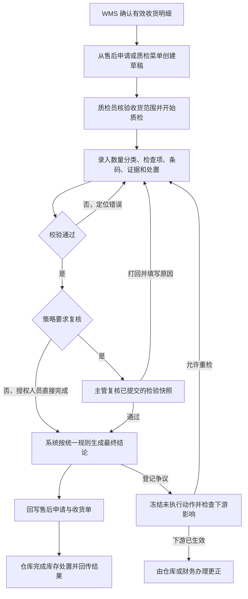

# OMS 质检单产品需求文档

V2.0 · 2026-11-19 · 评审稿

本稿正文为拟交付规则。第 10 节列出待确认的业务决策与会影响验收的原型差异。

## 1. 业务目标与范围

质检单记录退货实物的检验范围、数量分类、证据、最终结论及处置建议。质检结果供售后申请和仓库后续处置引用，WMS 回执决定库存状态，财务通过退款单决定退款金额。

| 范围 | 交付内容 |
| --- | --- |
| 首期基线 | 基于已签收 RMA 与有效 WMS 实收明细创建质检单。支持任务指派、检查项、条码与序列号、照片、数量分类、处置、按条件复核、争议及重检。 |
| 扩展场景 | 换货退回件随换货业务启用。采购入库、日常抽检和客诉沿用原型类型，待来源单据与仓库回写契约明确后开放。 |
| 权限角色 | 仓库有权人员创建，主管分配与处置异常，质检员录入并提交，独立复核人处理复核。客服只读查询及依权限登记争议。 |

**单据关联**　每张质检单有独立 QC ID。RMA、RN、收货批次及收货明细为来源引用。一个收货明细只能归属一张当前有效质检单，一个 RMA 可以关联多个互不重叠的收货范围。

## 2. 业务流程

质检状态、质检结论及 RMA 主状态分别展示。提交复核和打回均保留当前业务单据，最终结果在有权完成时发布。

## 3. 状态与流转

### 3.1 状态定义

| 状态 | 状态编码 | 操作及控制 |
| --- | --- | --- |
| 草稿 | draft | 仓库有权人员核验来源、指派任务、开始或取消。取消必填原因。 |
| 质检中 | in_progress | 指派质检员录入结果、条码和证据。所有行与必检项校验通过后提交复核。若策略免复核且操作人具备权限，可直接完成。 |
| 待复核 | pending_review | 有权主管复核通过或打回，打回必填原因。普通质检员只读。通过后生成最终结论。 |
| 已完成 | completed | 查看结果和关联单据，授权人员可登记争议。结论及其版本不可在原记录上覆盖。 |
| 有争议 | disputed | 查看争议原因、原证据和下游动作。待执行动作冻结；主管确认且下游允许时重检。已生效库存或支付进入更正流程。 |
| 已取消 | cancelled | 可查看和追溯，释放质检范围。关联实物继续保留在收货单，等待新任务或异常处理。 |

取消与草稿为灰色，质检中紫色，待复核蓝色，完成绿色，争议琥珀色。结论显示全部通过、部分通过或全部不通过，并用绿、琥珀、红辅助识别。

### 3.2 状态迁移及事件

| 当前状态 | 触发及前置 | 下一状态和下游变化 |
| --- | --- | --- |
| 无 | 有合法实收范围且创建成功 | draft，RMA 维持已签收。 |
| draft | 有权人员确认开始、范围版本一致 | in_progress，发质检开始事件。 |
| in_progress | 暂存 | in_progress，待复核与完成时间保持无值。 |
| in_progress | 校验通过且提交复核 | pending_review，冻结快照，无有效最终结论。 |
| in_progress | 校验通过、可免复核、确认完成 | completed，持久化最终结果及待回写事件。 |
| pending_review | 有权复核人通过且冻结快照当前有效 | completed，发布本版本最终结果。 |
| pending_review | 复核打回、填写原因 | in_progress，保留复核和打回记录，无最终结果事件。 |
| completed | 有权标记争议 | disputed，原结果保留，废止尚未执行的依赖资格并进入核验。 |
| disputed | 主管确认可重检且已完成必要冻结/更正 | in_progress，新一轮从已核准的收货版本重新检验。 |
| draft / in_progress / pending_review | 符合取消条件 | cancelled，释放有效范围，不删除收货或历史。 |

任何无效迁移返回当前状态、阻断原因和最新版号，不执行副作用。重复提交、回调按操作请求 ID 或 qcId + resultVersion 去重。下游回写失败时显示“质检已完成，结果待同步”并可重试。仓库和退款联动按第 8.2 节执行。

## 4. 列表、查询与展示

| 项目 | 取值与逻辑 |
| --- | --- |
| 权限范围 | 当前租户、公司、已授权商家及仓库。全部商家/仓库只聚合授权范围。先鉴权，再搜索、计数、排序和导出。 |
| 关键词范围 | 质检单号、来源单号（RMA 或后续启用的来源）、RN、质检员、当前指派人、仓库代码或名称。输入去首尾空白后整串匹配，大小写不敏感，各字段 OR。保留连字符、前导零及内部空格。空串表示不限。 |
| 状态 Tab | 全部、草稿 draft、质检中 in_progress、待复核 pending_review、已完成 completed、有争议 disputed、已取消 cancelled。计数应用除状态 Tab 外的条件。 |
| 筛选项 | 类型、仓库、优先级、结论为单选精确匹配。结论支持“未出结论”，只返回没有当前有效结论的单据。有争议单的历史结论在详情保留。非文本筛选与关键词及 Tab 按 AND 组合。 |
| 日期 | 补充筛选创建日期或完成日期，默认创建日期，选定一种时间维度。按业务时区转换为起始日零点含、结束日次日零点不含；允许单边空值。完成日期条件下未完成记录不匹配。倒置范围显示错误并保留上次结果。 |
| 搜索与重置 | 输入防抖 300 ms，Enter 立即搜索。改 Tab、关键词、筛选或排序回第 1 页；切 Tab 保留其他条件，重置清除筛选并还原排序。只应用最后一次请求的结果。 |
| 默认排序 | 全部及各 Tab 默认 createdAt DESC、id DESC。避免同时间单据跨页漂移。 |
| 可选排序 | 创建时间、完成时间、优先级、截止时间支持升降序；优先级按紧急 > 普通 > 低；任一主排序同值按 id 同向排列，空完成时间或截止时间始终置底。 |
| 分页 | 默认 20 条，可选 20 / 50 / 100；按过滤后总量分页。详情返回恢复条件、页码和排序；末页无记录时退回最后有效页。 |
| 汇总 | 质检单总数、进行中和已完成按同一非状态查询条件计数；良品与次品只统计当前已完成单据的有效结果，争议、已取消或重检中的历史版本不重复纳入。 |
| 导出和空态 | 开放导出权限后，按当前全部匹配结果和排序导出并重验权限。分别显示无单据、无匹配、查询失败并可重试。 |

| 列表列 | 数据来源与显示规则 |
| --- | --- |
| 质检单号、详情操作 | qcNo 只读，路由依 qcId 定位。复制使用原单号；已无权访问时提示并返回列表。 |
| 类型、来源单据 | qcType 映射业务文案。来源使用 sourceDoc.docNo 快照，点击按 sourceDoc.docId 跳转。RMA 质检附 RN 和批次用于识别。 |
| 仓库 / 质检区 | 仓库名称及代码、作业区分别展示；未指派作业区显示“—”。 |
| 状态、质检结论 | 分别来自 status、当前有效 conclusion。无有效结论显示“—”，争议另显示状态。 |
| 优先级、质检员 | 优先级来自 task.priority。质检尚未开始时显示当前指派人并标注“待开始”，已开始后展示实际质检员。 |
| 应收、良品、次品 | 逐行加总。应收取本单快照；结果未录入显示“—”，已确认且数量为零显示 0。已完成的数据来自有效版本。 |
| 完成时间 | 仅已完成的当前有效结果展示 completedAt，日期为业务时区。历史完成时间可在时间线查阅。 |

## 5. 页面交互与动态字段

| 页面 | 入口与交互 |
| --- | --- |
| 列表 | 售后管理 → 质检单。按状态、筛选和关键词查看，打开已存在的质检详情。 |
| 新建 | 支持独立菜单和已签收的 RMA 详情。RMA 入口可预选当前申请；已有关联有效质检时打开已有单。新建成功后回列表并提示 QC 单号及查看入口。 |
| 详情 | 按 QC ID 定位同一张质检单。展示来源、任务、收货范围、数量、扫码、清单、照片、处置、审核记录与结论。详情返回时保留列表条件。 |
| 取消与争议 | 从详情操作并填写原因。列表可查看进度及原因。已生效的库存、资金结果通过对应岗位更正。 |

### 5.1 新建与切换来源

| 触发条件 | 显示与默认值 | 重置、联动和校验 |
| --- | --- | --- |
| 首次打开 | 默认退货质检，来源类型为 RMA。选择有效 RMA 后展示单号、类型、退货仓和收货批次。 | 仅可选当前仓库权限内、存在 WMS 实收且有未检范围的 RMA。未匹配合法来源时禁止添加商品及提交。 |
| 选择来源与收货批次 | 展示 RN、收货仓、收货范围、应收和实收。库码和实收只读。 | 切换来源类型、单号或批次会清除依赖旧来源的商品、条码、序列号及仓库。已有录入时先提示，取消切换保留旧值。 |
| 仓库变化 | 从新收货单带入仓库，重新加载质检区、暂存位和人员候选。 | 清除旧仓的质检区、暂存位、不适用人员，使用新仓默认区。只接受有效主数据。 |
| 商品选择 | 展示当前批次可检行及已关联数量，来源行 ID 和 WMS 明细 ID 组合识别。 | 同 SKU 的不同来源行分别保留。应收及实收由来源带入，发现不符走收货更正。 |
| 模板选择 | 默认退货标准，按业务类型与仓库提供可用模板、版本。 | 切换会覆盖模板项；如已录入自定义项先确认。提交草稿后保留模板快照。 |
| 复核策略 | 质检中根据仓库策略、任务类型和当前异常判定是否必须复核。强制时显示并要求选复核人。 | 已指定复核人时走复核路径。候选为本仓授权主管或经理，复核人与本轮实际质检员不同。 |

### 5.2 详情的动态区块

| 条件 | 展示与编辑逻辑 |
| --- | --- |
| 草稿、质检中 | 草稿可配置任务并开始。质检中可录分类、检查项、扫描、证据、处置。实收与应收只读。 |
| 待复核 | 显示当前复核人、提交时间和冻结快照。授权复核人才有通过与打回按钮。打回后展示原因并恢复编辑。 |
| 直接完成 | 校验合格、复核策略允许且操作员有权时显示。弹窗预览系统计算结论并要求填说明，结论只读。 |
| 异常和处置 | 启用序列号的商品显示 SN 预期与实扫。次品、错货、序列号异常按策略要求说明和照片。上架或隔离时展示对应候选库位。切换处置方式移除不适用的计划库位。 |
| 完成与争议 | 展示有效结论、版本、复核记录、处置和关联单据。登记争议后显示冻结及下游影响。重新开启后历史结论仍可查，当前轮结论保持空，直到再次完成。 |
| 已取消 | 详情只读，显示取消原因、时间及历史证据，保留原收货单链接。 |

## 6. 字段字典

### 6.1 主单与任务

ID 引用按原值保存，业务单号、条码和 SN 不转成数值。空值用 null；必填文本调用服务端时去首尾空白。字段长度与默认值按本稿验收。

| 字段 | 来源、必填、默认 | 录入与校验 |
| --- | --- | --- |
| id / qcNo / taskNo | 保存草稿时服务端生成，均只读 | QC 编号建议 QC-YYYYMMDD-流水；实际 ID 唯一，任务编号与质检编号独立分配。重试同一请求返回已建单。 |
| tenantId / companyId / merchantId | 自登录授权和来源单带入 | 仓库、来源、人员、附件均必须匹配有效的作用域。 |
| qcType | 退货质检 rma 默认；换货回件 exchange 条件适用 | rma / exchange 的来源为实物售后申请。inbound / spot_check / complaint 为原型类型，来源接入后再启用。 |
| sourceDoc.type / docId / docNo / linkPath | 选来源后带入 ID、单号与显示信息，必填 | 类型字典 rma / purchase_order / inbound_order / ticket。首期可用 rma。按单号搜索候选后必须确认唯一来源 ID，跳转按 ID 构建并验证权限。 |
| returnOrderId / receiptOrderId / receiptBatchId | 从来源和已提交的 RN / 批次带入，RMA 场景必填 | 有实收才允许新建。以收货明细范围去重，两入口复用有效单。允许分批范围由首期配置决定。 |
| warehouseCode / warehouseName | 取有效收货单仓库，只读 | 使用仓库 ID 或代码做授权校验，名称为展示快照。来源变更需重算仓库与所有依赖数据。 |
| qcZone / tempStorageLocation / lpId | 质检区必填，有仓库默认值则带入；暂存位、LP 由收货记录优先带入 | 作业区和库位必须在本仓有效，可按仓库规则要求暂存位。LP 只能引用当前实收的容器记录。 |
| assignedTo / inspector | 指派人建单时选填，当前用户有同仓质检权限时可默认；实际检验者开始时必填 | 员工选择按本仓有效人员 ID 保存。开始及移交时写事件；实际质检员从认证身份取得。 |
| reviewer / reviewedBy / reviewRequired | 复核策略取仓库、类型或异常规则，保存策略快照。复核要求生效时必选复核人 | 候选为同仓有权限主管或经理，按人员 ID 校验。审批身份从会话取得。已指定复核人时进入复核路径，同一人不同时充当该轮质检员与复核人。 |
| priority / deadline / instructions | urgent 紧急、normal 普通默认、low 低；截止及注意事项选填 | 截止时间不得早于创建时刻，按仓库时区转换 UTC。超时只增加标识，不自动完成或取消。注意事项建议 2,000 字内。 |
| templateId / templateVersion | 默认退货标准 rma_standard；按商品类别、仓库策略选允许的模板 | 草稿切模板需提示覆盖尚未保存的自定义项。保存时冻结模板版本及快照，开始后可追加允许的补充项。 |
| status / conclusion / resultVersion | 新建为 draft；结论为空；结果版本在第一次完成时生成 | 状态只能由第 3.2 节动作推进。每次最终确认生成新结果版本，重检期间历史结论继续可查。 |
| createdAt / updatedAt / startedAt / submittedAt / reviewedAt / completedAt / cancelledAt | 服务端按相应事件写入 | 每次提交、打回及重检保留轮次记录；详情展示本轮时间，历史时间线不可覆盖。 |
| reviewNote / overallNote / cancelReason / disputeReason / reopenReason | 来自操作人，复核通过备注选填；质检说明、打回、取消、争议及重检原因必填 | 原因不接受纯空白，建议最多 500 字。取消采用来源取消、未到仓、重复创建、流程调整、其他。其他补充说明。 |

### 6.2 商品明细与检验记录

| 字段 | 来源、默认、权限 | 取值与联动 |
| --- | --- | --- |
| line.id / lineItemId / receiptLineId | 质检行 ID 系统生成；来源行及收货行从批次带入，只读 | 基于来源行与收货明细去重；不同订单行的相同 SKU 分行。移除已关联行必须先确认其收货范围处理方案。 |
| sku / title / variantTitle / unit | 取 WMS 收货记录与原订单快照，展示用 | 选品只给已关联收货范围，可按 SKU、名称包含匹配。录入意外商品时记录实物标识并联系异常处理。 |
| expectedQty | 从当前收货范围的应收预期带入，只读 | 绑定收货范围版本。总应收在来源汇总；同一原订单行分批到货时不能每个批次重复计算整单应收。 |
| receivedQty | 取 WMS 已确认实收，只读；没有有效数据不允许开始 | 修正走收货单，校验版本后刷新质检草稿。提交后的变更触发复核中断或更正流程，保留旧记录。 |
| goodQty / defectiveQty / wrongItemQty | 初始未录入，质检中由指派质检员填写；允许 0 | 非负整数，各项不超过实收；提交按第 7 节实收守恒。错货必记录实际 SKU 或标签及证据，无法识别先隔离核验。 |
| missingQty | 系统计算，只读 | 当期范围按第 7 节公式。分批未结收显示待收差异；仅结收确认的短缺进入最终结论。 |
| rowValidation | 由数量、SKU/SN、必检项及处置规则得到 | 列表行显示未录入、校验通过或需处理。失败按行提示差额和不满足条件。 |
| defectDescription / dispositionNote | 次品、错货、异常处置有说明；普通良品选填 | 描述不能为空白；建议各最多 500 字。按类记录问题及取证。 |
| disposition / dispositionQty | 记录处理类型和计划数量；无生效动作前可编辑 | restock 入库上架、scrap 报废、return_to_vendor 退供应商、repair 维修、quarantine 隔离。允许按行拆分，数量合计等于实收，报废与隔离分别统计。良品上架不超过良品数，错货不记入预期 SKU 库存。 |
| restockLocation / actualLocation | 普通上架计划选填，由 WMS 规则决定；执行库位来自回执 | 库位来自同仓有效主数据。隔离应引用可用隔离位；区分建议位和实际执行位。 |
| barcodeType / expectedBarcodes | 商品主数据或收货资料带入。字典 UPC / EAN / FNSKU / ASIN / 自定义 | 保存字符串，不能丢失前导零。按类型规则匹配，不把商品条码与唯一 SN 混为一类。无预期码时允许记录实扫证据并提示“缺少比对依据”。 |
| scannedBarcodes / scannedBy / scannedAt / scanStatus | 扫描或键盘逐次输入。人、时间由服务记录 | 未扫描 pending；已通过必要匹配 matched；存在错误 mismatch；超过应扫码次数 extra。重复扫描通用商品码可累计且按实收封顶；唯一序列号在本批次及已确认范围内去重。 |
| expectedSN / scannedSN | 序列化商品必须核验；预期从来源带入 | 数量与适用实物数量一致；错误或重复无法直接通过。未覆盖的错货 SN 需留异常记录，由有权限者决定是否隔离纳入本次质检。 |
| checklist.category / item / requirement | 分类 visual / functional / label / accessory / dimension / custom；名称必填、标准按模板要求 | 模板必检项不能删除。自定义项按分类和规范后的名称去重，避免同一项目重复统计。附加项需应用模板的权限。 |
| checklist.result / note | 默认未检。结果 pass / fail / na；人员可在质检中填写 | 必检项必须有结果。失败必有原因。不适用仅在模板允许时可填，且必有说明。整单必检项可阻断结论，行级检查影响对应实物分类。 |
| photo.scope / lineId / attachmentId / caption | 支持整体到仓、外包装、良品、缺陷、标签照；商品照片必须绑定行 | 来源文件由附件服务验证格式、大小及内容；阈值按仓库设定。上传完成才进入有效证据，未完成或失败的必需附件阻止提交。已提交版本的证据保留。 |
| uploadedBy / uploadedAt | 附件提交时产生，只读 | 按服务端身份和时间写入，附件预览重验权限。 |
| conclusion / overallNote / refundRecommendation | 结论按第 7 节统一计算；完成说明必填 | 同数据直接完成和复核通过必须产生同一结论。退款建议附依据，可为“需财务评估”；建议金额未知保留为空。展示已确定的结果版本。 |

## 7. 数量、结论与处置规则

### 7.1 数量守恒

- 所有数量为非负整数，单位与来源商品一致。以本质检范围内的预期收货和 WMS 确认的实收明细核对。
- 实收 = 良品 + 次品 + 错货。错货代表实际到仓的实物，需要记录实物标识；其计入收货诊断，不能增加预期 SKU 的库存。
- 短缺 = max（应收 − 实收，0）。例如应收 5、实收 4，其中良品 3、次品 1。结收确认后记短缺 1；未结收时显示待收 1。全部未收到时停留在收货异常路径，不能用一张零实收的质检单完成仓库处置。
- 同一来源行分批收货时，每次按当前收货范围创建或打开质检单。未到货部分保留在收货单的待收或经批准的短收差异。阶段性短收可随到货更新，最终确认短收须留原因。
- 错货与短缺可同时存在。应收 5、实收 5、其中错货 1 时，应记录数量短缺 0、错货 1、正确商品仅 4 件。超收或未归属的实物走仓库异常单据，禁止用其他行抵消。
- 同一收货明细最多归属一张有效质检单。创建和提交均重新校验版本、范围和数量，避免重复处理相同实物。

### 7.2 结论与处置

| 场景 | 结论和处理 |
| --- | --- |
| 所有应收件均实收且全部良品，必检项全部满足 | 全部通过。可售良品分配上架，库存状态由仓库结果回写。 |
| 有可接受良品，且另有缺陷、错货、最终短缺或其他已接受的部分异常 | 部分通过。逐项记录异常件处置和说明。 |
| 实收中无良品，或触发整批不通过的检验规则 | 全部不通过。必须指定隔离、报废、维修或退供应商等处置，并记录复核结论。 |
| 有待核实的条码、SN、超收、身份或短收差异 | 保留期间状态并安排复核或异常处理。差异完成确认后再提交最终结果。 |

- 良品率 = 良品数量 ÷ 实收总量。显示百分比可四舍五入，状态判定使用原始数量与检查规则。例：199 件良品与 1 件次品即使显示为 100%，仍为部分通过。
- 同行可按分类拆分处置数量。实物处置合计等于实收。上架数量不得超过对应良品数；隔离与报废分别计量；错货不得上架到预期 SKU；短缺无实物库存动作。
- 默认检查结果与处置需由质检员确认。退货原因、仓库差异、渠道政策和财务审批共同影响退款。质检结论与良品率给出依据，退款金额由退款单确定。

## 8. 操作、权限与系统联动

### 8.1 操作矩阵

适用但缺少前置条件时按钮禁用并说明原因。无操作权限或完全不适用时隐藏。详情与服务端同时校验版本及作用域，冲突时提示刷新，保留可重新录入的草稿。

| 操作 | 允许状态与角色 | 输入、处理与结果 |
| --- | --- | --- |
| 新建 / 选择商品 | 有实收的 RMA；本仓有创建权限 | 选来源、批次、商品与模板。提交重验未检范围，建 draft。同一范围已有有效单时打开已有单；部分范围重叠时提示需重新选品。 |
| 指派或改派 | 草稿；仓库主管。质检中改派需记录原因 | 校验人员有效仓库权限，记录前后指派人；改派后旧人不能继续提交。 |
| 开始质检 | draft；指派质检员或经授权的主管 | 确认质检人员、范围、收货版本和适用复核要求。成功转 in_progress，写 startedAt、事件并同步 RMA 进度。 |
| 编辑 / 暂存 | in_progress；本轮质检员有权限 | 编辑分类、证据、扫描、清单及处置计划，校验基础类型、重复引用和版本。暂存可保留未完录入，刷新后恢复。暂存不触发仓库动作。 |
| 增删商品行 | 草稿或质检中且尚未提交本轮；指定岗位 | 新增必须来自同批次合法实收范围。删除需说明，释放对应范围并保留已录证据的审计记录。禁止删除最后一行后提交。 |
| 扫描 / 删除误扫 | in_progress；质检员 | Enter 添加一次扫描，提示匹配、重复、不符或多余。误扫允许撤销并留操作信息；通用商品码和 SN 分开计数。 |
| 增删清单和照片 | 草稿或质检中，按权限 | 支持补充检查项和证据；冻结的必检项和已提交快照保留。上传失败给出该文件的重试入口。 |
| 提交复核 | in_progress；质检员 | 必填说明，校验所有行、必检项、处置、证据、收货版本。保存提交快照、复核人及提交时间，转 pending_review。 |
| 直接完成 | in_progress；策略免复核且操作人有权限 | 与提交复核同组校验，展示计算结论和下游影响，确认后保存最终版本并发送结果事件，转 completed。 |
| 复核通过 | pending_review；当前有权复核人 | 查看冻结快照，可填意见。复算结论并校验快照版本；保存 reviewedBy、结果和完成时间，转 completed。 |
| 打回重检 | pending_review；当前有权复核人 | 填写具体原因并定位到相关商品或检查项；追加复核记录，回 in_progress。保留原提交快照。 |
| 标记争议 | completed；有争议处理权限的仓库主管或运营 | 填必填原因。写争议及受影响的下游记录，转 disputed，通知相关部门并冻结仍可阻止的关联动作。 |
| 重新开启 | disputed；主管且下游允许 | 核验库存、财务动作及冻结结果，必填重检原因。保留旧结论和附件，创建新一轮 in_progress。已生效动作走关联更正流程。 |
| 取消 | draft / in_progress / pending_review；主管 | 必填原因，检查无有效结果或已生效的下游库存、资金动作。写取消时间，释放质检范围；RMA 保留真实签收，并按剩余有效质检任务重新显示待检进度。 |
| 查看及跳转 | 所有状态；查看者须有本仓数据权限 | 来源、RN、关联售后和下游动作按真实单号及 ID 查询。跨仓或跨商家链接服务端同样鉴权。 |

### 8.2 系统联动与审计

1. **创建**　RMA 有有效收货明细后允许创建质检。两个入口提交同一收货范围时复用已存在的有效质检单。检验期间 RMA 展示“质检中”，收货单保留累计实收。
2. **完成**　保存质检单号、版本、RMA ID、RN、收货批次、逐行收货引用、数量分类、结论、处置、证据引用及操作时间。OMS 回写售后与收货状态。全部通过可推进到仓库处置，部分通过或失败按业务决议推进。
3. **库存与 WMS**　按退货仓接入策略同步检验结论和处置。WMS 的 PDA 可采集 SKU、数量、Condition、LP 及适用 SN。若已有采集结果可带入作证据，OMS 保留复核与最终结论；最终处置和可售状态依仓库回执更新。WMS 流程中收货任务完成后的 RESTOCKED 与 LP IN_STOCK 表示仓库已登记，后续仍有上架任务。
4. **退款**　已确认生效的最终结论（复核通过或合规直接完成）及分类结果供退款单引用。争议状态冻结依赖该结论且尚未执行的动作。退款已执行时保留历史，以财务更正流程处理。
5. **可靠性与审计**　质检完成和结果事件一致保存，回写重试以质检单 ID 与结果版本去重。消费者识别过期版本。权限校验覆盖商家、仓库、角色、单据范围。日志保存创建、开始、提交、打回、完成、争议、重检和取消的操作者与原因。

## 9. 验收用例

| 编号 | 场景与操作 | 验收结果 |
| --- | --- | --- |
| QC-01 | 未签收 RMA 在独立菜单尝试创建；随后签收，从两个入口并发创建 | 未签收时拒绝；签收后同一收货范围只生成一张有效质检单。 |
| QC-02 | 应收 5、实收 4，录入良品 3、次品 1、最终短缺 1 | 校验通过并显示部分通过；短缺不计入实收和库存处置。 |
| QC-03 | 实收 4 件，分类仅录入 3 件或含重复 SN | 阻止提交并定位问题行，保留其他录入内容。 |
| QC-04 | 同 SKU 来自两条原订单行；一行实收中含良品和错货 | 两条来源行分别保留；良品上架和错货隔离分别计量。 |
| QC-05 | 199 良品、1 次品，经直接完成或复核通过 | 两条路径的结论均为部分通过，显示百分比不会改变结论。 |
| QC-06 | 强制复核任务提交，主管打回并说明原因 | 待复核期间不能编辑。打回后回质检中，保留历史，修正后可再提交。 |
| QC-07 | 已完成结果被重复回传，之后登记争议 | 下游只接收一次该版本。未执行动作冻结，已生效动作保留历史。 |
| QC-08 | 刷新列表和详情并切换账号 | 已提交的状态与附件可恢复；越权账号看不到或无法操作其他商家与仓库的单据。 |
| QC-09 | 关键词粘贴含首尾空格的 RN，同时选仓库与待复核 | RN 可命中；仅显示有权限、仓库匹配且处在待复核的记录，Tab 计数与页面一致。 |
| QC-10 | 完成时间降序，包含未完成及同时间记录 | 有完成时间倒序，空值排最后；并列 ID 顺序稳定。 |
| QC-11 | 扫两件相同 UPC、两件同一 SN、无预期商品码各一次 | UPC 可按数量登记，重复唯一 SN 被拒绝；无预期码不会伪报匹配。 |
| QC-12 | 必检项失败、附图上传中，质检员尝试提交 | 提示缺失说明或附件，定位对应项并保留录入内容。 |
| QC-13 | 强制复核且同一人尝试通过，随后真实复核人提交 | 首次拒绝，质检状态保持待复核；第二次以真实复核人员记录并发布一次结果。 |
| QC-14 | 已发布结果之后发现实收更正，WMS 已上架 | 保留旧结果和已上架记录，通过争议与更正处理。禁止直接在旧版本里修改实际数量。 |
| QC-15 | 在新建页选择商品后切换来源或批次 | 提示清理旧数据。确认切换后重新加载仓库与待检行，旧行不得保存到新来源。 |
| QC-16 | 已完成后标记争议，满足重检条件并重新开启 | 当前轮次无结论，历史结论与证据仍可查询。旧结论不触发新处置。 |

## 10. 评审决策与原型差异

| 决策项 | 本稿采用的评审基线 | 需确认 |
| --- | --- | --- |
| 数量口径 | WMS 实收只读，短缺单独计算，已确认短收才影响最终结论。 | WMS 错货归属、超收、收货更正与关闭短收接口。 |
| 复核策略 | 显式指定复核人或命中强制策略时进入复核；其他任务允许有权人员直接完成。 | 哪些仓库、商品、异常及高价值场景强制复核。 |
| 证据与模板 | 模板有版本，必检项和强制附件阻断提交。 | 各仓模板、照片要求、SN 与 Condition 到 OMS 分类的映射。 |
| 库存可售 | 质检输出建议去向，入库和可售状态以 WMS 处置和上架回执推进。 | 隔离、维修、报废、退供应商的状态回写及纠正方式。 |
| 多来源及分批 | 首期 RMA。批次以 WMS 收货明细为范围，依批次能力启用。 | 来源能力开放顺序，分批结收与最终短缺事件。 |

Demo 中实收由申请数预填、复核后按四舍五入后的良品率推导，重检会保留旧结论字段。本稿采用已确认实收、统一原始数量判定及当前结果版本机制。验收按本稿规则执行。

## 11. 参考资料

- 质检列表及新建 `src/app/dashboard/qc/`，质检详情与收货页 `src/app/dashboard/returns/[id]/qc/`、`src/app/dashboard/returns/[id]/receipt/`。
- 模拟模型 `src/lib/mock-data/return-orders.ts`，质检与库存演示规则 `src/features/oms/aftersales.ts`。
- [RMA 退货入库字段修订泳道图](https://chatgpt.com/library?file_id=libfile_897ba6f62e9081919bd99bb5def1cc59&account_id=personal)。

- [售后申请需求文档.md](https://chatgpt.com/library?file_id=libfile_2bf4129537bc8191a171f6eb9ca7addb&account_id=personal)。
